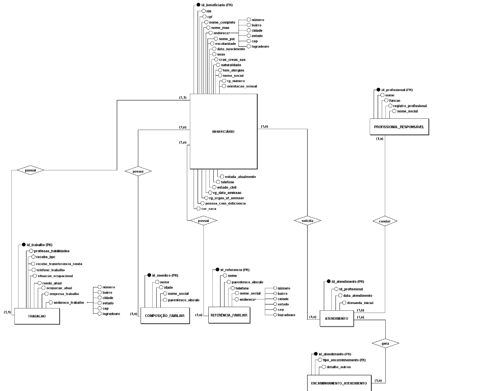

# Projeto de Modelagem Conceitual (DER) - Organização Social Nossa Senhora de Fátima

**Integrantes / Autores:**
* Gabriel Simões da Silva (RGM 47327383)
* Henrique Novais de Oliveira (RGM 47046996)
* Leandro Miranda da Silva (RGM 47397349)
* Mateus Alves dos Santos (RGM 47435887)
* Washington de Souza Silva (RGM 49080156)

---

# 0. Processo

## Triagem dos dados e DER

O fluxo operacional da Organização Social Nossa Senhora de Fátima baseia-se no atendimento de portas abertas para a população em situação de vulnerabilidade. A partir da entrevista presencial realizada pela assistente social, é feito o preenchimento da ficha de triagem (coleta de dados pessoais, ocupacionais, composição familiar e demandas sociais). 

Adicionalmente, a instituição gerencia o recebimento de doações de mantimentos de parceiros estratégicos (como o Banco de Alimentos e o projeto Cidade Invisível), a distribuição variável de cestas básicas conforme o diagnóstico de vulnerabilidade e o planejamento de atividades socioeducativas e de lazer para os assistidos.

Abaixo estão mapeados os processos do negócio e as regras operacionais identificadas na organização, bem como a cobertura atual prevista no modelo de dados conceitual.

---

### Tabela dos Processos do Negócio (Tabela I)

| Processo mapeado | Tipo | Situação |
| :--- | :--- | :--- |
| Recepção e acolhimento inicial do cidadão | Atendimento | Coberta |
| Triagem socioassistencial e anamnese social | Triagem | Coberta |
| Cadastro completo de beneficiários e dependentes | Cadastro | Coberta |
| Registro de atestados, laudos e vulnerabilidade familiar | Armazenamento | Coberta |
| Encaminhamento para redes externas (saúde, habitação, jurídica) | Atendimento | Coberta |
| Acompanhamento familiar continuado via PIA | Acompanhamento | Coberta (suportado pela entidade PIA) |
| Avaliação, montagem e concessão de cestas básicas e auxílios | Doação/Auxílio | Coberta (suportado pela entidade Entrega_Cesta) |
| Recebimento de doações de parceiros (Banco de Alimentos, etc.) | Arrecadação | Coberta (suportado pela entidade Recebimento_Doacao) |
| Controle de passeios e eventos socioeducativos | Atendimento | Parcial (registrado via ficha de atendimento) |
| Gestão e histórico de prontuários do beneficiário | Gestão | Coberta (através de chaves e histórico de atendimentos) |
| Gestão de estoque físico de alimentos e doações | Físico | Ausente (fora do escopo do modelo conceitual relacional) |
| Captação e escala de voluntários | Apoio | Ausente (fora do escopo do modelo atual) |
| Agenda de atendimentos e escala de profissionais | Operacional | Parcial (suportado pelo cadastro de Profissionais) |
| Prestação de contas e relatórios socioassistenciais (CRAS/SAS) | Relatório | Coberta (via agregação de dados de atendimentos, entregas e doações) |

*Legenda: Coberta = Processo totalmente mapeado no modelo conceitual; Parcial = Processo coberto de forma indireta ou limitada; Ausente = Processo sem cobertura no modelo atual.*

---

### Tabela das Regras de Negócio (Tabela II)

| Regra mapeada | O que faz | Situação |
| :--- | :--- | :--- |
| Permite apenas um CPF/NIS por beneficiário | Validação | Coberta (RN01) |
| Sigilo de triagem e acesso restrito (LGPD) | Triagem | Coberta (RN02) |
| Triagem socioassistencial obrigatória antes do encaminhamento | Triagem | Coberta (RN03) |
| Acompanhamento continuado (PIA) vinculado ao histórico | Acompanhamento | Coberta (RN04) |
| Limite estrutural de membros na composição familiar e referências | Validação | Coberta (RN10 / Dicionário de Dados) |
| Avaliação social obrigatória para concessão de auxílios | Triagem | Coberta (via Atendimento e Encaminhamentos) |
| Concessão variável de cestas conforme doações e vulnerabilidade | Doação | Coberta (RN05 / Registrada no Atendimento) |
| Controle de duplicidade e histórico na entrega de auxílios | Doação | Coberta (RN06 / Histórico de Atendimentos) |
| Obrigatoriedade de registro do profissional responsável (CRESS/CRP) | Triagem | Coberta (RN11 / Entidade Profissional) |
| Validade e integridade físico-sanitária das doações de alimentos | Doação | Coberta (RN09) |
| Consentimento, retenção e ciclo de vida de dados (LGPD) | Legislação | Coberta (RN07) |
| Periodicidade de entrega de cesta conforme doações | Doação | Parcial (registrada no fluxo de atendimento) |
| Controle de estoque físico de alimentos | Doação | Ausente (fora do escopo do modelo de dados) |
| Prestação de contas e relatórios para órgãos parceiros (CRAS/SAS) | Relatório | Coberta (RN08) |

*Legenda: Coberta = Regra mapeada com suporte direto nas entidades e atributos do modelo; Parcial = Presente no fluxo mas sem automação de estoque; Ausente = Regra sem cobertura no modelo conceitual atual.*

# 1. Diagnóstico do status e a organização

### Visão 1: O Acesso e levantamento do grupo

* **Nome e/ou sigla da organização:** Organização Social Nossa Senhora de Fátima (CNPJ: 32.667.614/0001-18).
  * **E-mail:** [ongnossasenhoradefatima@gmail.com](mailto:ongnossasenhoradefatima@gmail.com)
  * **Site:** [www.ongnossasenhoradefatima.com.br](http://www.ongnossasenhoradefatima.com.br)
  * **Assistente Social Responsável:** Maria Aparecida Fernandes Ferreira de Souza
  * **Telefone:** (11) 96972-4382
* **Acesso à ONG:** Contato direto por meio de voluntariado ativo no setor de um dos integrantes do grupo e entrevista presencial com a equipe técnica.
* **Descreva o porte:** Organização de pequeno porte, atendendo fixamente cerca de 250 famílias cadastradas na região. Conta com o Presidente e 5 voluntários recorrentes de forma fixa.
* **Serviços e como dados eram gerados:** Triagem e atendimento social presencial, encaminhamentos para moradia, saúde mental (AMA, CAPS, UBS), assistência jurídica e moradia universitária, além de distribuição de cestas básicas. Os dados eram gerados exclusivamente em formato manual através de fichas de atendimento impressas.
* **Problema a ser resolvido:** Centralização e digitalização das informações dos beneficiários. O controle atual é 100% físico e impresso, o que gera gargalos na troca de informações, risco de desgaste do papel e dificuldade na busca de históricos de atendimentos. O novo sistema eliminará a dependência do papel, garantindo agilidade e conformidade com a LGPD.

---

## 1.1. Descrição do Negócio

> Visão 1.1.1: Descrição e Funcionamento
* A Organização Social Nossa Senhora de Fátima é uma entidade sem fins lucrativos focada no acolhimento de pessoas em situação de vulnerabilidade social na região da Mooca. O fluxo operacional inicia-se no atendimento "de porta aberta", onde a assistente social realiza uma entrevista individualizada e preenche a ficha de triagem (dados pessoais, profissionais, composição familiar e demandas). A partir dessa avaliação, a ONG presta auxílio direto (montagem e entrega de cestas básicas não padronizadas) ou realiza encaminhamentos externos para redes de apoio (saúde mental, assistência jurídica, habitação e empregabilidade). Atualmente, a doação de alimentos é intermediada por parceiros como Banco de Alimentos e Cidade Invisível, e o controle de passeios sociais/culturais é organizado nos finais de semana. O novo sistema automatizará o registro cadastral, o histórico de demandas e os encaminhamentos efetuados.

---

## 2. Requisitos do Sistema
> Visão 2: O que o sistema precisa fazer e ter para resolver as necessidades da ONG.

### 2.1 Requisitos Funcionais (RF)
* **RF01 — Cadastro de Beneficiários:** O sistema deve permitir o registro completo de beneficiários e seus dependentes, validando a unicidade por CPF ou NIS.
* **RF02 — Registo de Triagem Socioassistencial:** O sistema deve armazenar as fichas de triagem preenchidas pela assistente social, contendo dados socioeconómicos, situação familiar e laudos.
* **RF03 — Gestão de Atendimentos e Encaminhamentos:** O sistema deve registrar os atendimentos realizados e os encaminhamentos efetuados para a rede externa de apoio.
* **RF04 — Registo de Concessão de Auxílios:** O sistema deve permitir o registro da distribuição de cestas básicas e doações de forma variável conforme a necessidade e a disponibilidade.
* **RF05 — Acompanhamento Continuado (PIA):** O sistema deve suportar o registro e a evolução do Plano Individual de Atendimento (PIA) conduzido pela equipe técnica.
* **RF06 — Consulta e Histórico:** O sistema deve permitir a consulta ao histórico de atendimentos e triagens anteriores de um beneficiário cadastrado.

### 2.2 Requisitos Não Funcionais (RNF)
* **RNF01 — Segurança e Sigilo de Dados (LGPD):** O sistema deve aplicar controle de acesso baseado em papéis (RBAC), garantindo que dados sensíveis e laudos socioassistenciais sejam acessíveis exclusivamente por profissionais autorizados.
* **RNF02 — Desempenho e Escalabilidade:** As consultas de beneficiários por CPF, NIS ou nome devem retornar resultados em até 2 segundos, mantendo a estabilidade mesmo com o crescimento gradual do volume de atendimentos.
* **RNF03 — Integridade Relacional:** O banco de dados deve assegurar a integridade referencial estrita por meio de chaves primárias e estrangeiras obrigatórias.
* **RNF04 — Disponibilidade e Tolerância a Falhas:** O SGBD deve garantir disponibilidade contínua durante o horário de atendimento da instituição, contando com rotinas automatizadas de backup diário e plano de recuperação de dados.
* **RNF05 — Usabilidade e Interface:** A interface do sistema deve ser intuitiva, ágil e de fácil navegação para otimizar o preenchimento de fichas por assistentes sociais e voluntários da recepção.
* **RNF06 — Auditoria de Registros:** O sistema deve registrar automaticamente a data, hora, usuário e tipo de operação (inserção, alteração ou exclusão/anonimização) para garantir rastreabilidade nos prontuários.

---

# 3. Regras de Negócio (RN)

As regras de negócio abaixo definem as restrições operacionais, validações de dados e requisitos legais que orientam a modelagem do banco de dados e a rotina da instituição.

---

### RN01 — Unicidade de Identificação (CPF/NIS)
* **Descrição:** Cada beneficiário cadastrado no sistema deve possuir apenas um registro ativo associado ao seu número de CPF ou NIS (Número de Identificação Social).
* **Motivação:** Evitar cadastros duplicados de uma mesma pessoa ou família no sistema da ONG.
* **Tipo:** Validação de Dados / Restrição do Banco.

---

### RN02 — Sigilo e Restrição de Acesso às Triagens (LGPD)
* **Descrição:** Os dados coletados durante a triagem socioassistencial (informações financeiras, relatórios de vulnerabilidade e prontuários) são confidenciais e restritos à equipe de assistência social autorizada.
* **Motivação:** Garantir o cumprimento da Lei Geral de Proteção de Dados (LGPD) e a privacidade dos atendidos.
* **Tipo:** Segurança e Controle de Acesso.

---

### RN03 — Triagem Obrigatória Prévia
* **Descrição:** Nenhum beneficiário poderá receber encaminhamentos para a rede externa de apoio, participar de programas continuados ou receber auxílios materiais sem que haja pelo menos um registro de triagem social válido e atualizado.
* **Motivação:** Garantir que os auxílios e encaminhamentos sejam destinados prioritariamente às famílias que realmente passam por avaliação de vulnerabilidade.
* **Tipo:** Regra de Processo / Fluxo de Atendimento.

---

### RN04 — Acompanhamento Continuado e PIA
* **Descrição:** Famílias inseridas no Plano Individual de Atendimento (PIA) devem ter seus registros de acompanhamento, evolução temporal e metas vinculados diretamente ao histórico conduzido pela equipe técnica.
* **Motivação:** Permitir a evolução temporal do quadro socioeconômico da família e o acompanhamento estruturado das metas de autonomia.
* **Tipo:** Acompanhamento / Histórico.

---

### RN05 — Concessão Variável de Cestas Básicas e Doações
* **Descrição:** A distribuição de cestas básicas e itens de doação não possui quantidade fixa por beneficiário; ela varia estritamente em função da disponibilidade de estoque/doações de parceiros e do grau de necessidade apurado na triagem.
* **Motivação:** Refletir a realidade operacional da ONG, onde a oferta depende de doadores externos e a demanda é priorizada pela assistente social.
* **Tipo:** Regra Operacional de Doação.

---

### RN06 — Critério de Elegibilidade e Periodicidade de Auxílios
* **Descrição:** A concessão de cestas básicas por família observa critérios de elegibilidade baseados na renda per capita apurada na triagem e respeita um intervalo mínimo de periodicidade entre as entregas, salvo em situações de calamidade avaliadas pela equipe.
* **Motivação:** Assegurar a distribuição justa, transparente e rotativa dos recursos limitados da instituição entre as famílias cadastradas.
* **Tipo:** Regra de Controle de Doação.

---

### RN07 — Consentimento, Retenção e Ciclo de Vida de Dados (LGPD)
* **Descrição:** O cadastro de informações socioeconômicas e laudos exige o consentimento expresso do titular (ou responsável legal), mantendo o histórico de prontuários arquivado pelo período estipulado pelas normativas do terceiro setor e de assistência social (5 anos), com posterior descarte seguro ou anonimização.
* **Motivação:** Garantir conformidade jurídica, respaldo legal na prestação de contas e respeito à privacidade dos assistidos.
* **Tipo:** Legislação e Governança de Dados.

---

### RN08 — Prestação de Contas e Relatórios Socioassistenciais
* **Descrição:** O sistema deve permitir a agregação de dados consolidados sobre o volume de atendimentos, perfil dos assistidos, doações recebidas e número de cestas distribuídas para a elaboração de relatórios destinados a órgãos parceiros (CRAS, SAS e doadores).
* **Motivação:** Atender às obrigações estatutárias da ONG e prestar contas de forma transparente sobre a aplicação dos recursos e doações recebidas.
* **Tipo:** Governança e Relatoria.

---

### RN09 — Validade e Integridade Físico-Sanitária dos Alimentos
* **Descrição:** Todos os alimentos e cestas básicas recebidos de doadores parceiros devem passar por verificação de prazo de validade e integridade física antes de serem registrados no sistema e disponibilizados para doação aos beneficiários.
* **Motivação:** Assegurar a segurança alimentar, a qualidade e a saúde dos assistidos pela instituição.
* **Tipo:** Regra de Controle e Qualidade de Doações.

---

### RN10 — Limite Estrutural Familiar e de Referências
* **Descrição:** Conforme a estrutura da ficha de cadastro da ONG, o sistema limita o registro direto na tabela de composição familiar a até 5 membros dependentes e a até 3 pessoas de contato/emergência na tabela de referências familiares.
* **Motivação:** Manter o alinhamento com o formulário físico de triagem e garantir a padronização no dimensionamento dos atendimentos e auxílios.
* **Tipo:** Validação de Dados / Restrição Estrutural.

---

### RN11 — Obrigatoriedade de Registro do Profissional Responsável (CRESS/CRP)
* **Descrição:** Todo atendimento socioassistencial, elaboração de PIA, concessão de auxílios e registro de doações deve obrigatoriamente estar vinculado a um profissional habilitado da equipe técnica cadastrado com seu respectivo registro no conselho de classe (ex.: CRESS ou CRP).
* **Motivação:** Garantir a responsabilidade técnica e legal pelas decisões e acompanhamentos sociais realizados na instituição.
* **Tipo:** Validação Operacional e Conformidade Técnica.

---

### 4.0 Convenções de Engenharia de Dados e Governança

* **SGBD Alvo:** MySQL v8.0+
* **Encoding e Collation:** `UTF-8` / `utf8mb4_unicode_ci`
* **Notação Formal:** Modelo Entidade-Relacionamento (Notação Chen / Merise)
* **Convenção de Nomenclatura:** Nomes de tabelas e atributos em minúsculo com separação por sublinhado (`snake_case`). Chaves primárias iniciadas com `id_`.
* **Compatibilidade de Tipos:** Todas as chaves primárias (PK) e chaves estrangeiras (FK) utilizam o tipo padronizado `BIGINT UNSIGNED` para assegurar a integridade referencial no MySQL.
* **Política de Indexação:** Além das Chaves Primárias (PK) e Estrangeiras (FK), são criados índices B-Tree para otimização de busca frequente nos campos `cpf`, `nis` e `nome_completo`.

#### Governança de Dados, LGPD e Matriz de Papéis
> Diretrizes de conformidade jurídica, retenção e permissões de acesso baseadas nas normativas da LGPD e do SuAS.

**Classificação dos Dados:**
* **Interno:** Chaves, datas de controle e dados operacionais (ex: `id_beneficiario`, `quantidade_cestas`).
* **Pessoal:** Dados pessoais comuns nos termos do Art. 5º, I da LGPD (ex: `nome_completo`, `cpf`, `telefone`, `endereco`).
* **Sensível:** Dados pessoais sensíveis nos termos do Art. 5º, II da LGPD (ex: `cor_raca`, `orientacao_sexual`, `pessoa_com_deficiencia`, `tem_alergias`).
* **Sigiloso:** Dados protegidos pelo sigilo profissional da triagem e assistência social (ex: `renda_atual`, `demanda_inicial`, `metas_objetivos`).

**Bases Legais e Diretrizes:**
* **Dados Pessoais Comuns:** Art. 7º, I (Consentimento do Titular) da LGPD.
* **Dados Sensíveis:** Art. 11, I (Consentimento expresso do titular ou responsável legal) e Art. 11, II, "a" (Cumprimento de obrigação legal por legislação federal/estadual do SuAS).
* **Retenção e Expurgo:** Os cadastros e prontuários são mantidos por **5 anos** após o último atendimento do beneficiário, em conformidade com as diretrizes do SuAS/CRAS, sendo submetidos a anonimização ou expurgo seguro após este período.

**Matriz de Papéis por Operação (I: Inserir, L: Ler, A: Alterar, N: Anonimizar):**
| Categoria de Dados | TÉCNICO (Assistente Social / Psicólogo) | ADMIN (Coordenação / Presidência) | VOLUNTÁRIO (Recepção / Apoio) |
| :--- | :---: | :---: | :---: |
| **Internos e Pessoais** (Cadastro, Família, Trabalho) | I, L, A | I, L, A | L |
| **Sensíveis** (Raça, Deficiência, Alergias) | I, L, A | - | - |
| **Sigiloso** (Renda, Prontuários, PIA) | I, L, A | - | - |
| **Entrega de Cestas** (`entrega_cesta`) | I, L, A | L | I, L |

---

### 4.1 Entidade: Beneficiário
*(Centraliza a identificação do cidadão assistido)*

| Atributo | Descrição | Domínio / Tipo Físico | Índice | Obrig. | Classe LGPD |
| :--- | :--- | :--- | :---: | :---: | :--- |
| `id_beneficiario` | Identificador único | `BIGINT UNSIGNED AUTO_INCREMENT` | PK | Sim | Interno |
| `nis` | Identificação Social | `VARCHAR(15)` | Index | Não | Pessoal |
| `cras_creas_sas` | Equipamento vinculado | `VARCHAR(100)` | Não | Não | Interno |
| `nome_completo` | Nome civil | `VARCHAR(150)` | Index | Sim | Pessoal |
| `nome_social` | Nome de preferência | `VARCHAR(150)` | Não | Não | Pessoal |
| `sexo` | Sexo biológico/declarado | `CHAR(1)` | Não | Sim | Pessoal |
| `orientacao_sexual` | Orientação autodeclarada | `VARCHAR(30)` | Não | Não | Sensível |
| `data_nascimento` | Data de nascimento | `DATE` | Não | Sim | Pessoal |
| `naturalidade` | Cidade/UF de origem | `VARCHAR(100)` | Não | Não | Pessoal |
| `cor_raca` | Cor/raça autodeclarada | `VARCHAR(20)` | Não | Não | Sensível |
| `pessoa_com_deficiencia` | Condição de PCD / CID | `VARCHAR(100)` | Não | Não | Sensível |
| `tem_alergias` | Restrições alimentares | `VARCHAR(150)` | Não | Não | Sensível |
| `cpf` | Registro de CPF | `VARCHAR(14)` | Index/Unique | Não | Pessoal |
| `rg_numero` | Documento RG | `VARCHAR(20)` | Não | Não | Pessoal |
| `rg_orgao_uf_emissor` | Órgão emissor RG | `VARCHAR(20)` | Não | Não | Pessoal |
| `rg_data_emissao` | Data de emissão RG | `DATE` | Não | Não | Pessoal |
| `estado_civil` | Estado civil | `VARCHAR(20)` | Não | Não | Pessoal |
| `endereco` | Endereço residencial | `VARCHAR(200)` | Não | Sim | Pessoal |
| `bairro` | Bairro | `VARCHAR(100)` | Não | Não | Pessoal |
| `cep` | Código postal | `VARCHAR(9)` | Não | Não | Pessoal |
| `telefone` | Telefone principal | `VARCHAR(20)` | Não | Não | Pessoal |
| `nome_mae` | Nome da mãe | `VARCHAR(150)` | Não | Não | Pessoal |
| `nome_pai` | Nome do pai | `VARCHAR(150)` | Não | Não | Pessoal |
| `escolaridade` | Nível de instrução | `VARCHAR(50)` | Não | Não | Pessoal |
| `estuda_atualmente` | Vínculo escolar atual | `VARCHAR(100)` | Não | Não | Pessoal |
| `recebe_transferencia_renda`| Programas sociais | `VARCHAR(100)` | Não | Não | Sigiloso |
| `recebe_bpc` | Recebimento de BPC | `VARCHAR(50)` | Não | Não | Sigiloso |
| `situacao_cadastro` | Status do cadastro | `VARCHAR(20)` (ATIVO/ANONIMIZADO) | Não | Sim | Interno |
| `data_consentimento` | Data do aceite LGPD | `DATE` | Não | Sim | Interno |

---

### 4.2 Entidade: Trabalho
*(Perfil ocupacional e socioeconômico - isolado para normalização 1FN/2FN)*

| Atributo | Descrição | Domínio / Tipo Físico | Índice | Obrig. | Classe LGPD |
| :--- | :--- | :--- | :---: | :---: | :--- |
| `id_trabalho` | Identificador único | `BIGINT UNSIGNED AUTO_INCREMENT` | PK | Sim | Interno |
| `id_beneficiario` | Beneficiário vinculado | `BIGINT UNSIGNED` | FK | Sim | Interno |
| `situacao_ocupacional` | Condição de trabalho | `VARCHAR(50)` | Não | Sim | Pessoal |
| `profissao_habilidades` | Habilidades e cursos | `TEXT` | Não | Não | Pessoal |
| `renda_atual` | Renda mensal individual | `DECIMAL(10,2)` | Não | Não | Sigiloso |
| `empresa_trabalho` | Nome do empregador | `VARCHAR(150)` | Não | Não | Pessoal |
| `ocupacao_atual` | Função exercida | `VARCHAR(100)` | Não | Não | Pessoal |
| `telefone_trabalho` | Telefone comercial | `VARCHAR(20)` | Não | Não | Pessoal |

---

### 4.3 Entidade: Composição Familiar (`composicao_familiar`)
*(Membros dependentes que residem no mesmo domicílio - até 5 membros)*

| Atributo | Descrição | Domínio / Tipo Físico | Índice | Obrig. | Classe LGPD |
| :--- | :--- | :--- | :---: | :---: | :--- |
| `id_membro` | Identificador do membro | `BIGINT UNSIGNED AUTO_INCREMENT` | PK | Sim | Interno |
| `id_beneficiario` | Titular da família | `BIGINT UNSIGNED` | FK | Sim | Interno |
| `nome` | Nome civil do familiar | `VARCHAR(150)` | Não | Sim | Pessoal |
| `idade` | Idade em anos | `TINYINT UNSIGNED` | Não | Sim | Pessoal |
| `parentesco_vinculo` | Grau de parentesco | `VARCHAR(50)` | Não | Sim | Pessoal |

---

### 4.4 Entidade: Referência Familiar (`referencia_familiar`)
*(Contatos externos e de emergência - até 3 referências)*

| Atributo | Descrição | Domínio / Tipo Físico | Índice | Obrig. | Classe LGPD |
| :--- | :--- | :--- | :---: | :---: | :--- |
| `id_referencia` | Identificador do contato | `BIGINT UNSIGNED AUTO_INCREMENT` | PK | Sim | Interno |
| `id_beneficiario` | Beneficiário vinculado | `BIGINT UNSIGNED` | FK | Sim | Interno |
| `nome` | Nome do contato | `VARCHAR(150)` | Não | Sim | Pessoal |
| `parentesco_vinculo` | Relação/vínculo | `VARCHAR(50)` | Não | Não | Pessoal |
| `telefone` | Telefone de contato | `VARCHAR(20)` | Não | Não | Pessoal |

---

### 4.5 Entidade: Atendimento
*(Registro das entrevistas e anamneses sociais)*

| Atributo | Descrição | Domínio / Tipo Físico | Índice | Obrig. | Classe LGPD |
| :--- | :--- | :--- | :---: | :---: | :--- |
| `id_atendimento` | Identificador da sessão | `BIGINT UNSIGNED AUTO_INCREMENT` | PK | Sim | Interno |
| `id_beneficiario` | Beneficiário atendido | `BIGINT UNSIGNED` | FK | Sim | Interno |
| `id_profissional` | Técnico condutor | `BIGINT UNSIGNED` | FK | Sim | Interno |
| `data_atendimento` | Data do atendimento | `DATE` | Index | Sim | Interno |
| `demanda_inicial` | Necessidade relatada | `TEXT` | Não | Sim | Sigiloso |

---

### 4.6 Entidade: Encaminhamento (`encaminhamento_atendimento`)
*(Direcionamentos para redes externas derivados de um atendimento)*

| Atributo | Descrição | Domínio / Tipo Físico | Índice | Obrig. | Classe LGPD |
| :--- | :--- | :--- | :---: | :---: | :--- |
| `id_encaminhamento` | Identificador único | `BIGINT UNSIGNED AUTO_INCREMENT` | PK | Sim | Interno |
| `id_atendimento` | Atendimento de origem | `BIGINT UNSIGNED` | FK | Sim | Interno |
| `tipo_encaminhamento` | Categoria do encaminhamento | `VARCHAR(60)` | Não | Sim | Sigiloso |
| `detalhe_outros` | Especificação técnica | `TEXT` | Não | Cond. | Sigiloso |

---

### 4.7 Entidade: Profissional Responsável (`profissional_responsavel`)
*(Equipe técnica da ONG - CRESS/CRP)*

| Atributo | Descrição | Domínio / Tipo Físico | Índice | Obrig. | Classe LGPD |
| :--- | :--- | :--- | :---: | :---: | :--- |
| `id_profissional` | Identificador do profissional | `BIGINT UNSIGNED AUTO_INCREMENT` | PK | Sim | Interno |
| `nome` | Nome completo | `VARCHAR(150)` | Não | Sim | Pessoal |
| `funcao` | Cargo / Função | `VARCHAR(50)` | Não | Sim | Interno |
| `registro_profissional` | Conselho de classe (CRESS/CRP) | `VARCHAR(30)` | Não | Sim | Interno |

---

### 4.8 Entidade: PIA (Plano Individual de Atendimento)
*(Acompanhamento continuado e evolução social)*

| Atributo | Descrição | Domínio / Tipo Físico | Índice | Obrig. | Classe LGPD |
| :--- | :--- | :--- | :---: | :---: | :--- |
| `id_pia` | Identificador do plano | `BIGINT UNSIGNED AUTO_INCREMENT` | PK | Sim | Interno |
| `id_beneficiario` | Beneficiário titular | `BIGINT UNSIGNED` | FK | Sim | Interno |
| `id_profissional` | Técnico responsável | `BIGINT UNSIGNED` | FK | Sim | Interno |
| `data_criacao` | Data de elaboração | `DATE` | Não | Sim | Interno |
| `metas_objetivos` | Metas de autonomia | `TEXT` | Não | Sim | Sigiloso |
| `prazo_reavaliacao` | Previsão de retorno | `DATE` | Não | Não | Interno |

---

### 4.9 Entidade: Entrega de Cesta (`entrega_cesta`)
*(Registro e auditoria de doações diretas)*

| Atributo | Descrição | Domínio / Tipo Físico | Índice | Obrig. | Classe LGPD |
| :--- | :--- | :--- | :---: | :---: | :--- |
| `id_entrega` | Identificador da entrega | `BIGINT UNSIGNED AUTO_INCREMENT` | PK | Sim | Interno |
| `id_beneficiario` | Beneficiário recebedor | `BIGINT UNSIGNED` | FK | Sim | Interno |
| `id_profissional` | Técnico autorizador | `BIGINT UNSIGNED` | FK | Sim | Interno |
| `data_entrega` | Data de concessão | `DATE` | Index | Sim | Interno |
| `quantidade_cestas` | Volume concedido | `INT` | Não | Sim | Interno |
| `itens_adicionais` | Doações complementares | `TEXT` | Não | Não | Interno |

---

### 4.10 Entidade: Recebimento de Doação (`recebimento_doacao`)
*(Registro de entrada de mantimentos enviados por parceiros)*

| Atributo | Descrição | Domínio / Tipo Físico | Índice | Obrig. | Classe LGPD |
| :--- | :--- | :--- | :---: | :---: | :--- |
| `id_recebimento` | Identificador da doação | `BIGINT UNSIGNED AUTO_INCREMENT` | PK | Sim | Interno |
| `id_profissional` | Técnico recebedor | `BIGINT UNSIGNED` | FK | Sim | Interno |
| `parceiro_doador` | Nome do doador (ex: Banco de Alimentos) | `VARCHAR(100)` | Não | Sim | Interno |
| `data_recebimento` | Data de entrada | `DATE` | Index | Sim | Interno |
| `descricao_itens` | Descrição dos itens doados | `TEXT` | Não | Sim | Interno |
| `quantidade_total` | Volume/peso recebido | `INT` | Não | Sim | Interno |

---

### 4.11 Ciclo de Vida do Fluxo de Dados

1. **Recepção e Termo LGPD:** O assistido assina o termo de consentimento LGPD e é registrado em `beneficiario` (`data_consentimento` preenchida e `situacao_cadastro = 'ATIVO'`).
2. **Triagem Socioassistencial:** O profissional habilitado conduz a entrevista e gera um registro em `atendimento`, inserindo a demanda inicial, além de atualizar o perfil em `trabalho`, `composicao_familiar` e `referencia_familiar`.
3. **Desdobramentos do Atendimento:** A partir do atendimento, o sistema permite derivar encaminhamentos externos (`encaminhamento_atendimento`), conceder cestas básicas (`entrega_cesta`, validando elegibilidade e intervalo) e iniciar o acompanhamento continuado (`pia`).
4. **Entrada de Mantimentos:** As doações enviadas por instituições parceiras são registradas em `recebimento_doacao` pelo profissional responsável.
5. **Consultas e Relatórios:** O histórico do assistido pode ser consultado para acompanhamento (RF06), gerando relatórios agregados e anonimizados para prestação de contas aos órgãos parceiros (RN08).
6. **Encerrando o Ciclo (LGPD):** Após 5 anos do último atendimento, ou por solicitação do titular, o cadastro é submetido à rotina de anonimização (`situacao_cadastro = 'ANONIMIZADO'`).

---

## 5. Modelagem Conceitual - Entidades e Relacionamentos
> Visão 5.1: Modelo Conceitual do BD

### Entidades Reconhecidas
* **`BENEFICIÁRIO`**: Centraliza os dados individuais e cadastrais do cidadão atendido.
* **`TRABALHO`**: Armazena o perfil ocupacional, renda e dados do local de trabalho de forma isolada do beneficiário.
* **`COMPOSIÇÃO_FAMILIAR`**: Guarda as informações dos membros dependentes que residem no mesmo domicílio (até 5 membros).
* **`REFERÊNCIA_FAMILIAR`**: Armazena os contatos externos e de emergência do beneficiário (até 3 referências).
* **`ATENDIMENTO`**: Registra as sessões de triagem, demandas iniciais e profissionais responsáveis.
* **`PROFISSIONAL_RESPONSAVEL`**: Cadastra a equipe técnica que realiza os atendimentos na ONG.
* **`ENCAMINHAMENTO_ATENDIMENTO`**: Registra os direcionamentos e encaminhamentos externos gerados a partir de um atendimento.
* **`PIA`**: Registra o Plano Individual de Atendimento e as metas de acompanhamento continuado da família.
* **`ENTREGA_CESTA`**: Armazena o registro histórico da distribuição de cestas básicas e auxílios materiais aos beneficiários.
* **`RECEBIMENTO_DOACAO`**: Armazena o registro histórico das entradas e doações de mantimentos recebidas de parceiros estratégicos.

### Relacionamentos e Cardinalidades
* **BENEFICIÁRIO (1,1) --- POSSUI --- (0,n) TRABALHO**: Um beneficiário pode possuir registros de trabalho associados ao seu perfil ocupacional, e cada registro de trabalho pertence a um único beneficiário.
* **BENEFICIÁRIO (1,1) --- POSSUI --- (0,n) COMPOSIÇÃO_FAMILIAR**: Cada membro da composição familiar pertence obrigatoriamente a um único beneficiário titular, e um beneficiário pode possuir vários membros familiares cadastrados.
* **BENEFICIÁRIO (1,1) --- POSSUI --- (0,n) REFERÊNCIA_FAMILIAR**: Um beneficiário titular pode registrar referências de apoio, e cada referência está vinculada a um único beneficiário.
* **BENEFICIÁRIO (1,1) --- SOLICITA --- (0,n) ATENDIMENTO**: Um beneficiário pode solicitar múltiplos atendimentos ao longo do tempo, e cada atendimento está vinculado a um único beneficiário solicitante.
* **PROFISSIONAL_RESPONSAVEL (1,1) --- CONDUZ --- (0,n) ATENDIMENTO**: Um profissional da equipe técnica pode conduzir vários atendimentos, e cada atendimento é conduzido por um único profissional responsável.
* **ATENDIMENTO (1,1) --- GERA --- (0,n) ENCAMINHAMENTO_ATENDIMENTO**: Um atendimento pode gerar nenhum ou múltiplos encaminhamentos externos, e cada encaminhamento pertence obrigatoriamente a um único atendimento de origem.
* **BENEFICIÁRIO (1,1) --- POSSUI --- (0,n) PIA**: Um beneficiário pode possuir planos de atendimento continuado ao longo de sua evolução na ONG, e cada PIA pertence a um único beneficiário.
* **PROFISSIONAL_RESPONSAVEL (1,1) --- ELABORA --- (0,n) PIA**: Um profissional técnico pode elaborar múltiplos planos de atendimento, e cada PIA é elaborado por um único profissional responsável.
* **BENEFICIÁRIO (1,1) --- RECEBE --- (0,n) ENTREGA_CESTA**: Um beneficiário pode receber múltiplas entregas de cestas básicas ao longo do tempo, e cada entrega está vinculada a um único beneficiário.
* **PROFISSIONAL_RESPONSAVEL (1,1) --- REGISTRA --- (0,n) ENTREGA_CESTA**: Um profissional pode registrar várias entregas de auxílios, e cada entrega é registrada por um único profissional.
* **PROFISSIONAL_RESPONSAVEL (1,1) --- REGISTRA --- (0,n) RECEBIMENTO_DOACAO**: Um profissional da equipe pode registrar a entrada de doações de parceiros no sistema, e cada lote doado está vinculado a um profissional autorizador.

---

## 6. Diagrama Entidade-Relacionamento (DER)
> Visão 6.1: O seu DER para a ONG

---

## 7. Justificativa Técnica
> Visão 7.1: Explicar as escolhas da modelagem do BD para a ONG.

### Escolha das Entidades e Atribuição de Atributos
* **BENEFICIÁRIO:** Entidade central do sistema. Armazena os dados demográficos e de identificação individual do assistido (`cpf`, `nis`, `nome_completo`, `data_nascimento`, `escolaridade`, `pessoa_com_deficiencia`, `orientacao_sexual`, etc.). O endereço foi modelado para detalhamento geográfico.
* **TRABALHO:** Entidade isolada para armazenar as informações socioeconômicas e ocupacionais (`renda_atual`, `situacao_ocupacional`, `empresa_trabalho`, `ocupacao_atual`, `telefone_trabalho`), garantindo a normalização adequada em relação aos dados pessoais do beneficiário.
* **COMPOSIÇÃO_FAMILIAR:** Guarda `nome`, `idade` e `parentesco_vinculo` dos moradores da mesma residência, respeitando o limite estrutural de até 5 membros.
* **REFERÊNCIA_FAMILIAR:** Guarda `nome`, `parentesco_vinculo` e `telefone` da pessoa de contato externo para emergências (até 3 referências), desvinculada de endereço residencial próprio.
* **ATENDIMENTO:** Mapeia os encontros entre a equipe técnica e o assistido através da chave `id_atendimento`, vinculando o `id_profissional`, a `data_atendimento` e a `demanda_inicial`.
* **PROFISSIONAL_RESPONSAVEL:** Controla o cadastro da equipe técnica com `id_profissional`, `nome`, `funcao` e `registro_profissional` (ex.: CRESS ou CRP).
* **ENCAMINHAMENTO_ATENDIMENTO:** Entidade dependente vinculada por chave estrangeira a `ATENDIMENTO`, mapeando as ações e direcionamentos institucionais externos.
* **PIA:** Entidade essencial para cumprir a regra de negócio **RN04** e o requisito funcional **RF05**. Permite registrar a evolução temporal, objetivos e metas traçadas pela assistente social para a autonomia da família atendida.
* **ENTREGA_CESTA:** Entidade criada para gerenciar de forma transparente a principal atividade de auxílio direto da ONG (conforme **RN05** e **RN06**), auditando quantidades e datas de auxílios.
* **RECEBIMENTO_DOACAO:** Criada para suprir a rastreabilidade de entradas de mantimentos recebidos de parceiros estratégicos (como o Banco de Alimentos), registrando data, itens e volumes doados.

### Justificativa das Cardinalidades do Modelo
* **BENEFICIÁRIO (1,1) --- POSSUI --- (0,n) TRABALHO:** Todo registro ocupacional pertence obrigatoriamente a exatamente 1 beneficiário titular (1,1). Já o beneficiário pode ter 0 ou múltiplos registros históricos (0,n).
* **BENEFICIÁRIO (1,1) --- POSSUI --- (0,n) COMPOSIÇÃO_FAMILIAR:** Cada dependente está associado a exatamente 1 titular (1,1), podendo o beneficiário possuir vários membros familiares cadastrados (0,n).
* **BENEFICIÁRIO (1,1) --- POSSUI --- (0,n) REFERÊNCIA_FAMILIAR:** Cada contato de emergência pertence a 1 beneficiário (1,1), que pode indicar múltiplos contatos (0,n).
* **BENEFICIÁRIO (1,1) --- SOLICITA --- (0,n) ATENDIMENTO:** Cada atendimento é de 1 único beneficiário (1,1), e este pode possuir vários atendimentos no histórico (0,n).
* **PROFISSIONAL_RESPONSAVEL (1,1) --- CONDUZ --- (0,n) ATENDIMENTO:** Cada atendimento é assinado por 1 único profissional (1,1), e o técnico pode conduzir vários atendimentos (0,n).
* **ATENDIMENTO (1,1) --- GERA --- (0,n) ENCAMINHAMENTO_ATENDIMENTO:** Cada registro de encaminhamento deriva obrigatoriamente de 1 atendimento de origem (1,1), podendo um atendimento gerar nenhum ou múltiplos encaminhamentos externos (0,n).
* **BENEFICIÁRIO (1,1) --- POSSUI --- (0,n) PIA:** Cada Plano Individual pertence a 1 beneficiário (1,1), que pode possuir múltiplos planos ao longo do tempo (0,n).
* **PROFISSIONAL_RESPONSAVEL (1,1) --- ELABORA --- (0,n) PIA:** Cada PIA é elaborado por 1 único profissional responsável (1,1), que pode gerenciar múltiplos planos (0,n).
* **BENEFICIÁRIO (1,1) --- RECEBE --- (0,n) ENTREGA_CESTA:** Cada entrega de cesta é destinada a 1 beneficiário (1,1), compondo um histórico de entregas periódicas (0,n).
* **PROFISSIONAL_RESPONSAVEL (1,1) --- REGISTRA --- (0,n) ENTREGA_CESTA:** Cada entrega de auxílio é registrada por 1 único profissional autorizador (1,1).
* **PROFISSIONAL_RESPONSAVEL (1,1) --- REGISTRA --- (0,n) RECEBIMENTO_DOACAO:** Cada lote de doação recebido de parceiros é registrado no sistema por 1 único profissional responsável (1,1).

### Decisões de Abstração e Alternativas Rejeitadas
* **Uso de PKs Sintéticas (`id_*`):** Rejeitou-se o uso de `cpf` ou `nis` como Chave Primária (PK) em `BENEFICIÁRIO`, pois indivíduos em extrema vulnerabilidade podem não possuir esses documentos no primeiro atendimento.
* **Normalização de Listas e Tabelas Secundárias (1FN):** Manter membros da família ou dados de trabalho na mesma tabela geraria repetição de dados, sendo solucionado com entidades dedicadas.
* **Histórico Atemporal:** Transformar atendimentos, encaminhamentos e entregas em entidades independentes vinculadas por chaves estrangeiras permite rastrear a evolução do cidadão sem sobrescrever dados históricos.

---

## 8. Uso de Inteligência Artificial
> Registro detalhado do uso de ferramentas de Inteligência Artificial no apoio à estruturação técnico-acadêmica, modelagem conceitual e validação de dados do projeto.

* **Ferramentas de IA utilizadas:** Google Gemini, OpenAI ChatGPT e Anthropic Claude.
* **Etapas de uso:** 
  * Estruturação e formatação da documentação técnica em Markdown e transcrição do Dicionário de Dados.
  * Compreensão profunda e refinamento dos fluxos operacionais e regras de negócio da Organização Social.
  * Mapeamento e análise crítica de riscos de modelagem e restrições legais (como conformidade com a LGPD).
  * Construção, refinamento e validação detalhada do dicionário de dados conceitual por entidades.
  * Verificação rigorosa de cardinalidades e relacionamentos, eliminando ambiguidades lógicas e pontas duplas indevidas.
  * Identificação e correção iterativa de possíveis erros conceituais, estruturais e de normalização (1FN).
* **Motivação:** Elevar o rigor técnico do projeto utilizando uma abordagem multilocal/multimodelos, permitindo cruzar diferentes perspectivas arquiteturais das IAs para garantir que o modelo relacional estivesse robusto, livre de inconsistências e alinhado às melhores práticas de bancos de dados, além de atender estritamente aos critérios de correção do professor.
* **Prompt(s) utilizados (exemplos):** 
  * *"Analise as regras de negócio e a ficha de triagem da ONG Nossa Senhora de Fátima para identificar potenciais riscos de modelagem, falhas de normalização e inconsistências estruturais."*
  * *"Com base nos apontamentos do professor, ajude a revisar e corrigir as cardinalidades dos relacionamentos (substituindo pontas duplas 1,n por 1,1 e 0,n onde aplicável) e a isolar a entidade Trabalho de forma normalizada."*
  * *"Organize a documentação técnica e estruture as tabelas do dicionário de dados conceitual no esqueleto Markdown exigido."*
* **Resposta recebida:** As ferramentas de IA retornaram análises detalhadas apontando a necessidade de isolamento de atributos socioeconômicos na entidade `TRABALHO`, a substituição das cardinalidades ambíguas de `(1,n)` para `(1,1) --- (0,n)`, a inclusão de controle de acessos alinhado à LGPD e diretrizes do SuAS, além de minutas de tabelas em Markdown para o Dicionário de Dados com convenções de nomenclatura (`snake_case`) e chaves sintéticas.
* **Fontes e verificações:** O grupo submeteu as propostas das IAs a uma curadoria rigorosa, cruzando cada sugestão diretamente com a ficha física real da ONG, com a teoria de modelagem relacional de banco de dados e com as observações apontadas na avaliação docente.
* **Rejeições/Correções:** Diversas sugestões iniciais geradas pelas IAs precisaram de ajustes manuais, como a readequação de nomes de atributos para o padrão `snake_case`, a correção de cardinalidades que vieram inicialmente ambíguas e a adaptação de termos genéricos para a realidade específica da assistência social brasileira (CRAS, CADÚnico, PIA).
* **Justificativa da Escolha Final e Reflexão Crítica:** O uso conjunto de LLMs (Gemini, ChatGPT e Claude) atuou como uma camada preliminar de auditoria e estruturação documental. Contudo, a decisão arquitetural final foi estritamente humana e baseada nos critérios normativos de modelagem de dados e nas exigências técnicas da assistência social. Todas as sugestões das IAs foram submetidas ao crivo do grupo: rejeitamos a criação de tabelas desnecessárias (como estoque físico, fora do escopo do modelo conceitual) e mantivemos o foco nas entidades centrais exigidas pela rotina presencial da ONG e pelo professor (como PIA e Entrega de Cestas), garantindo a fidelidade às diretrizes do SuAS/LGPD.

---

## 9. Conclusão e Avaliação dos Integrantes

### Considerações Finais
O desenvolvimento e refinamento iterativo da modelagem conceitual para a Organização Social Nossa Senhora de Fátima permitiu ao grupo vivenciar na prática a transição de um processo puramente manual (baseado em papel) para uma arquitetura de dados relacional moderna, normalizada e estruturada. O projeto possibilitou transpor os desafios teóricos para a realidade prática, corrigindo inconsistências estruturais — como o isolamento adequado de perfis ocupacionais e o ajuste rigoroso de cardinalidades. O sistema proposto solucionará os principais problemas apontados pela equipe técnica: a perda de agilidade nos atendimentos, a dificuldade no acompanhamento histórico dos beneficiários e a estrita adequação às diretrizes da LGPD no tratamento de dados sensíveis e socioeconômicos.

---

## 10. Referências
* ORGANIZAÇÃO SOCIAL NOSSA SENHORA DE FÁTIMA. **Ficha de Cadastro e Triagem Socioassistencial**. São Paulo, 2026. Entrevista e pesquisa de campo concedidas à equipe acadêmica.

