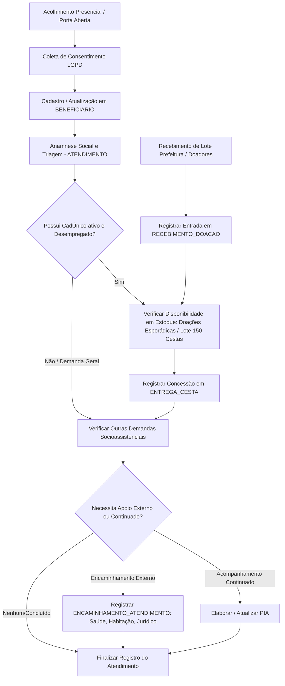
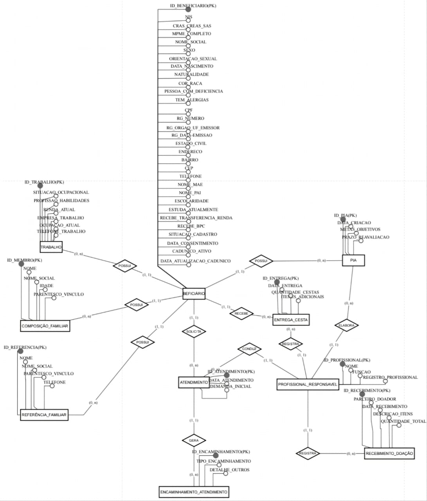

# Projeto de Banco de Dados: Do Modelo Conceitual à Implementação SQL — Organização Social Nossa Senhora de Fátima 

**Integrantes / Autores:**
* Gabriel Simões da Silva (RGM 4732733) - @Gabriel-Simoes2006
* Henrique Novais de Oliveira (RGM 47046996) - @henriqueisabella11-creator
* Leandro Miranda da Silva (RGM 47397349) - @mirandaleandro-creator
* Mateus Alves dos Santos (RGM 47435887) - @mateusalvesantos2025-dev
* Washington de Souza Silva (RGM 49080156) - @washingtondesouzasilva1980-collab

---

# 0. Processo

## Triagem dos dados

O fluxo operacional da Organização Social Nossa Senhora de Fátima baseia-se no atendimento de portas abertas para a população em situação de vulnerabilidade. A partir da entrevista presencial realizada pela assistente social, é feito o preenchimento da ficha de triagem (coleta de dados pessoais, ocupacionais, composição familiar e demandas sociais). 

Adicionalmente, a instituição gerencia o recebimento de doações de mantimentos de parceiros estratégicos (como o Banco de Alimentos e o projeto Cidade Invisível), a distribuição variável de cestas básicas conforme o diagnóstico de vulnerabilidade e o planejamento de atividades socioeducativas e de lazer para os assistidos.

Abaixo estão mapeados os processos do negócio e as regras operacionais identificadas na organização, bem como a cobertura atual prevista no modelo de dados conceitual.

### Fluxograma do Processo Socioassistencial e Concessão de Auxílios

---

### Tabela dos Processos do Negócio (Tabela I)

| Processo mapeado | Tipo | Situação |
| :--- | :--- | :--- |
| Recepção e acolhimento inicial do cidadão | Atendimento | Coberta |
| Triagem socioassistencial e anamnese social | Triagem | Coberta |
| Cadastro completo de beneficiários e dependentes | Cadastro | Coberta |
| Registro de atestados, laudos e vulnerabilidade familiar | Armazenamento | Coberta |
| Encaminhamento para redes externas (saúde, habitação, jurídica) | Atendimento | Coberta |
| Acompanhamento familiar continuado via PIA | Acompanhamento | Coberta (suportado pela entidade PIA) |
| Avaliação, montagem e concessão de cestas básicas e auxílios | Doação/Auxílio | Coberta (suportado pela entidade Entrega_Cesta) |
| Recebimento de doações de parceiros (Banco de Alimentos, etc.) | Arrecadação | Coberta (suportado pela entidade Recebimento_Doacao) |
| Controle de passeios e eventos socioeducativos | Atendimento | Parcial (registrado via ficha de atendimento) |
| Gestão e histórico de prontuários do beneficiário | Gestão | Coberta (através de chaves e histórico de atendimentos) |
| Gestão de estoque físico de alimentos e doações | Físico | Ausente (fora do escopo do modelo conceitual relacional) |
| Captação e escala de voluntários | Apoio | Ausente (fora do escopo do modelo atual) |
| Agenda de atendimentos e escala de profissionais | Operacional | Parcial (suportado pelo cadastro de Profissionais) |
| Prestação de contas e relatórios socioassistenciais (CRAS/SAS) | Relatório | Coberta (via agregação de dados de atendimentos, entregas e doações) |

*Legenda: Coberta = Processo totalmente mapeado no modelo conceitual; Parcial = Processo coberto de forma indireta ou limitada; Ausente = Processo sem cobertura no modelo atual.*

---

### Tabela das Regras de Negócio (Tabela II)

| Regra mapeada | O que faz | Situação |
| :--- | :--- | :--- |
| Permite apenas um CPF/NIS por beneficiário | Validação | Coberta (RN01) |
| Sigilo de triagem e acesso restrito (LGPD) | Triagem | Coberta (RN02) |
| Triagem socioassistencial obrigatória antes do encaminhamento | Triagem | Coberta (RN03) |
| Acompanhamento continuado (PIA) vinculado ao histórico | Acompanhamento | Coberta (RN04) |
| Limite estrutural de membros na composição familiar e referências | Validação | Coberta (RN10 / Dicionário de Dados) |
| Avaliação social obrigatória para concessão de auxílios | Triagem | Coberta (via Atendimento e Encaminhamentos) |
| Concessão variável de cestas (doações esporádicas e lote bimestral da Prefeitura) | Doação | Coberta (RN05 / Registrada no Atendimento) |
| Critério de elegibilidade prioritária (desemprego e CadÚnico ativo) e histórico | Doação | Coberta (RN06 / Histórico de Atendimentos) |
| Controle de duplicidade e histórico na entrega de auxílios | Doação | Coberta (RN06 / Histórico de Atendimentos) |
| Obrigatoriedade de registro do profissional responsável (CRESS/CRP) | Triagem | Coberta (RN11 / Entidade Profissional) |
| Validade e integridade físico-sanitária das doações de alimentos | Doação | Coberta (RN09) |
| Consentimento, retenção e ciclo de vida de dados (LGPD) | Legislação | Coberta (RN07) |
| Periodicidade de entrega de cesta conforme doações | Doação | Parcial (registrada no fluxo de atendimento) |
| Controle de estoque físico de alimentos | Doação | Ausente (fora do escopo do modelo de dados) |
| Prestação de contas e relatórios para órgãos parceiros (CRAS/SAS) | Relatório | Coberta (RN08) |

*Legenda: Coberta = Regra mapeada com suporte direto nas entidades e atributos do modelo; Parcial = Presente no fluxo mas sem automação de estoque; Ausente = Regra sem cobertura no modelo conceitual atual.*

# 1. Diagnóstico do status e a organização

### Visão 1: O Acesso e levantamento do grupo

* **Nome e/ou sigla da organização:** Organização Social Nossa Senhora de Fátima (CNPJ: 32.667.614/0001-18).
  * **E-mail:** [ongnossasenhoradefatima@gmail.com](mailto:ongnossasenhoradefatima@gmail.com)
  * **Site:** [www.ongnossasenhoradefatima.com.br](http://www.ongnossasenhoradefatima.com.br)
  * **Assistente Social Responsável:** Maria Aparecida Fernandes Ferreira de Souza
  * **Telefone:** (11) 96972-4382
* **Acesso à ONG:** Contato direto por meio de voluntariado ativo no setor de um dos integrantes do grupo e entrevista presencial com a equipe técnica.
* **Descreva o porte:** Organização de pequeno porte, atendendo fixamente cerca de 250 famílias cadastradas na região. Conta com o Presidente e 5 voluntários recorrentes de forma fixa.
* **Serviços e como dados eram gerados:** Triagem e atendimento social presencial, encaminhamentos para moradia, saúde mental (AMA, CAPS, UBS), assistência jurídica e moradia universitária, além de distribuição de cestas básicas. Os dados eram gerados exclusivamente em formato manual através de fichas de atendimento impressas.
* **Problema a ser resolvido:** Centralização e digitalização das informações dos beneficiários. O controle atual é 100% físico e impresso, o que gera gargalos na troca de informações, risco de desgaste do papel e dificuldade na busca de históricos de atendimentos. O novo sistema eliminará a dependência do papel, garantindo agilidade e conformidade com a LGPD.
* **Levantamento detalhado e fotos da visita:** O relatório completo e o registro fotográfico encontram-se disponíveis na pasta [levantamento/](./levantamento/).

---

## 1.1. Descrição do Negócio

> Visão 1.1.1: Descrição e Funcionamento
* A Organização Social Nossa Senhora de Fátima é uma entidade sem fins lucrativos focada no acolhimento de pessoas em situação de vulnerabilidade social na região da Mooca. O fluxo operacional inicia-se no atendimento "de porta aberta", onde a assistente social realiza uma entrevista individualizada e preenche a ficha de triagem (dados pessoais, profissionais, composição familiar e demandas). A partir dessa avaliação, a ONG presta auxílio direto (montagem e entrega de cestas básicas não padronizadas) ou realiza encaminhamentos externos para redes de apoio (saúde mental, assistência jurídica, habitação e empregabilidade). Atualmente, a doação de alimentos é intermediada por parceiros como Banco de Alimentos e Cidade Invisível, e o controle de passeios sociais/culturais é organizado nos finais de semana. O novo sistema automatizará o registro cadastral, o histórico de demandas e os encaminhamentos efetuados.

---

## 2. Requisitos do Sistema
> Visão 2: O que o sistema precisa fazer e ter para resolver as necessidades da ONG.

### 2.1 Requisitos Funcionais (RF)
* **RF01 — Cadastro de Beneficiários:** O sistema deve permitir o registro completo de beneficiários e seus dependentes, validando a unicidade por CPF ou NIS quando informados.
* **RF02 — Registro de Triagem Socioassistencial:** O sistema deve armazenar as fichas de triagem preenchidas pela assistente social, contendo dados socioeconômicos, situação familiar e laudos.
* **RF03 — Gestão de Atendimentos e Encaminhamentos:** O sistema deve registrar os atendimentos realizados e os encaminhamentos efetuados para a rede externa de apoio.
* **RF04 — Registro de Concessão de Auxílios:** O sistema deve permitir o registro da distribuição de cestas básicas e doações de forma variável conforme a necessidade e a disponibilidade.
* **RF05 — Acompanhamento Continuado (PIA):** O sistema deve suportar o registro e a evolução do Plano Individual de Atendimento (PIA) conduzido pela equipe técnica.
* **RF06 — Consulta e Histórico:** O sistema deve permitir a consulta ao histórico de atendimentos e triagens anteriores de um beneficiário cadastrado.

### 2.2 Requisitos Não Funcionais (RNF)
* **RNF01 — Segurança e Sigilo de Dados (LGPD):** O sistema deve aplicar controle de acesso baseado em papéis (RBAC), garantindo que dados sensíveis e laudos socioassistenciais sejam acessíveis exclusivamente por profissionais autorizados.
* **RNF02 — Desempenho e Escalabilidade:** As consultas de beneficiários por CPF, NIS ou nome devem retornar resultados em até 2 segundos, mantendo a estabilidade mesmo com o crescimento gradual do volume de atendimentos.
* **RNF03 — Integridade Relacional:** O banco de dados deve assegurar a integridade referencial estrita por meio de chaves primárias e estrangeiras obrigatórias.
* **RNF04 — Disponibilidade e Tolerância a Falhas:** O SGBD deve garantir disponibilidade contínua durante o horário de atendimento da instituição, contando com rotinas automatizadas de backup diário e plano de recuperação de dados.
* **RNF05 — Usabilidade e Interface:** A interface do sistema deve ser intuitiva, ágil e de fácil navegação para otimizar o preenchimento de fichas por assistentes sociais e voluntários da recepção.
* **RNF06 — Auditoria de Registros:** O sistema deve registrar automaticamente a data, hora, usuário e tipo de operação (inserção, alteração ou exclusão/anonimização) para garantir rastreabilidade nos prontuários.

---

# 3. Regras de Negócio (RN)

As regras de negócio abaixo definem as restrições operacionais, validações de dados e requisitos legais que orientam a modelagem do banco de dados e a rotina da instituição.

---

### RN01 — Unicidade de Identificação (CPF/NIS)
* **Descrição:** Cada beneficiário cadastrado no sistema deve possuir apenas um registro ativo associado ao seu número de CPF ou NIS (Número de Identificação Social).
* **Motivação:** Evitar cadastros duplicados de uma mesma pessoa ou família no sistema da ONG.
* **Tipo:** Validação de Dados / Restrição do Banco.

---

### RN02 — Sigilo e Restrição de Acesso às Triagens (LGPD)
* **Descrição:** Os dados coletados durante a triagem socioassistencial (informações financeiras, relatórios de vulnerabilidade e prontuários) são confidenciais e restritos à equipe de assistência social autorizada.
* **Motivação:** Garantir o cumprimento da Lei Geral de Proteção de Dados (LGPD) e a privacidade dos atendidos.
* **Tipo:** Segurança e Controle de Acesso.

---

### RN03 — Triagem Obrigatória Prévia
* **Descrição:** Nenhum beneficiário poderá receber encaminhamentos para a rede externa de apoio, participar de programas continuados ou receber auxílios materiais sem que haja pelo menos um registro de triagem social válido e atualizado.
* **Motivação:** Garantir que os auxílios e encaminhamentos sejam destinados prioritariamente às famílias que realmente passam por avaliação de vulnerabilidade.
* **Tipo:** Regra de Processo / Fluxo de Atendimento.

---

### RN04 — Acompanhamento Continuado e PIA
* **Descrição:** Famílias inseridas no Plano Individual de Atendimento (PIA) devem ter seus registros de acompanhamento, evolução temporal e metas vinculados diretamente ao histórico conduzido pela equipe técnica.
* **Motivação:** Permitir a evolução temporal do quadro socioeconômico da família e o acompanhamento estruturado das metas de autonomia.
* **Tipo:** Acompanhamento / Histórico.

---

### RN05 — Concessão Variável e Origem dos Mantimentos (Doações e Prefeitura)
* **Descrição:** A distribuição de cestas básicas não possui quantidade fixa por beneficiário. O estoque da ONG é composto por duas frentes: doações esporádicas de mantimentos vindas de parceiros e doadores particulares (de forma não fixa), e um lote institucional de 150 cestas básicas recebido a cada 2 meses (bimestralmente) oriundo de parceria com a Prefeitura.
* **Motivação:** Refletir com precisão a flutuação do estoque da instituição, que mescla doações irregulares/voluntárias com o repasse programado do poder público.
* **Tipo:** Regra Operacional de Doação.

---

### RN06 — Critério de Elegibilidade Prioritária para Auxílios
* **Descrição:** Para ter prioridade na concessão de cestas básicas e auxílios materiais, a família assistida deve obrigatoriamente atender a dois critérios principais apurados na triagem: estar em situação de desemprego formal (sem registro ativo em carteira) e possuir o Cadastro Único (CadÚnico) ativo e atualizado. Exceções emergenciais de calamidade podem ser avaliadas discricionariamente pela assistente social.
* **Motivação:** Assegurar que os recursos limitados da instituição (como o lote bimestral da Prefeitura) sejam direcionados estritamente às famílias em maior vulnerabilidade social e formalmente enquadradas nas diretrizes do SuAS.
* **Tipo:** Regra de Controle de Doação.

---

### RN07 — Consentimento, Retenção e Ciclo de Vida de Dados (LGPD)
* **Descrição:** O cadastro de informações socioeconômicas e laudos exige o consentimento expresso do titular (ou responsável legal), mantendo o histórico de prontuários arquivado pelo período estipulado pelas normativas do terceiro setor e de assistência social (5 anos), com posterior descarte seguro ou anonimização.
* **Motivação:** Garantir conformidade jurídica, respaldo legal na prestação de contas e respeito à privacidade dos assistidos.
* **Tipo:** Legislação e Governança de Dados.

---

### RN08 — Prestação de Contas e Relatórios Socioassistenciais
* **Descrição:** O sistema deve permitir a agregação de dados consolidados sobre o volume de atendimentos, perfil dos assistidos, doações recebidas e número de cestas distribuídas para a elaboração de relatórios destinados a órgãos parceiros (CRAS, SAS e doadores).
* **Motivação:** Atender às obrigações estatutárias da ONG e prestar contas de forma transparente sobre a aplicação dos recursos e doações recebidas.
* **Tipo:** Governança e Relatoria.

---

### RN09 — Validade e Integridade Físico-Sanitária dos Alimentos
* **Descrição:** Todos os alimentos e cestas básicas recebidos de doadores parceiros devem passar por verificação de prazo de validade e integridade física antes de serem registrados no sistema e disponibilizados para doação aos beneficiários.
* **Motivação:** Assegurar a segurança alimentar, a qualidade e a saúde dos assistidos pela instituição.
* **Tipo:** Regra de Controle e Qualidade de Doações.

---

### RN10 — Limite Estrutural Familiar e de Referências
* **Descrição:** Conforme a estrutura da ficha de cadastro da ONG, o sistema limita o registro direto na tabela de composição familiar a até 5 membros dependentes e a até 3 pessoas de contato/emergência na tabela de referências familiares.
* **Motivação:** Manter o alinhamento com o formulário físico de triagem e garantir a padronização no dimensionamento dos atendimentos e auxílios.
* **Tipo:** Validação de Dados / Restrição Estrutural.

---

### RN11 — Obrigatoriedade de Registro do Profissional Responsável (CRESS/CRP)
* **Descrição:** Todo atendimento socioassistencial, elaboração de PIA, concessão de auxílios e registro de doações deve obrigatoriamente estar vinculado a um profissional habilitado da equipe técnica cadastrado com seu respectivo registro no conselho de classe (ex.: CRESS ou CRP).
* **Motivação:** Garantir a responsabilidade técnica e legal pelas decisões e acompanhamentos sociais realizados na instituição.
* **Tipo:** Validação Operacional e Conformidade Técnica.

---

## 4. Modelagem Conceitual - Entidades e Relacionamentos
> Visão 4.1: Modelo Conceitual do BD

### Entidades Reconhecidas
* **`BENEFICIÁRIO`**: Centraliza os dados individuais e cadastrais do cidadão atendido.
* **`TRABALHO`**: Armazena o perfil ocupacional, renda e dados do local de trabalho de forma isolada do beneficiário.
* **`COMPOSIÇÃO_FAMILIAR`**: Guarda as informações dos membros dependentes que residem no mesmo domicílio (até 5 membros).
* **`REFERÊNCIA_FAMILIAR`**: Armazena os contatos externos e de emergência do beneficiário (até 3 referências).
* **`ATENDIMENTO`**: Registra as sessões de triagem, demandas iniciais e profissionais responsáveis.
* **`PROFISSIONAL_RESPONSAVEL`**: Cadastra a equipe técnica que realiza os atendimentos na ONG.
* **`ENCAMINHAMENTO_ATENDIMENTO`**: Registra os direcionamentos e encaminhamentos externos gerados a partir de um atendimento.
* **`PIA`**: Registra o Plano Individual de Atendimento e as metas de acompanhamento continuado da família.
* **`ENTREGA_CESTA`**: Armazena o registro histórico da distribuição de cestas básicas e auxílios materiais aos beneficiários.
* **`RECEBIMENTO_DOACAO`**: Armazena o registro histórico das entradas e doações de mantimentos recebidas de parceiros estratégicos.

### Relacionamentos e Cardinalidades
* **BENEFICIÁRIO (1,1) --- POSSUI --- (0,n) TRABALHO**: Um beneficiário pode possuir registros de trabalho associados ao seu perfil ocupacional, e cada registro de trabalho pertence a um único beneficiário.
* **BENEFICIÁRIO (1,1) --- POSSUI --- (0,n) COMPOSIÇÃO_FAMILIAR**: Cada membro da composição familiar pertence obrigatoriamente a um único beneficiário titular, e um beneficiário pode possuir vários membros familiares cadastrados.
* **BENEFICIÁRIO (1,1) --- POSSUI --- (0,n) REFERÊNCIA_FAMILIAR**: Um beneficiário titular pode registrar referências de apoio, e cada referência está vinculada a um único beneficiário.
* **BENEFICIÁRIO (1,1) --- SOLICITA --- (0,n) ATENDIMENTO**: Um beneficiário pode solicitar múltiplos atendimentos ao longo do tempo, e cada atendimento está vinculado a um único beneficiário solicitante.
* **PROFISSIONAL_RESPONSAVEL (1,1) --- CONDUZ --- (0,n) ATENDIMENTO**: Um profissional da equipe técnica pode conduzir vários atendimentos, e cada atendimento é conduzido por um único profissional responsável.
* **ATENDIMENTO (1,1) --- GERA --- (0,n) ENCAMINHAMENTO_ATENDIMENTO**: Um atendimento pode gerar nenhum ou múltiplos encaminhamentos externos, e cada encaminhamento pertence obrigatoriamente a um único atendimento de origem.
* **BENEFICIÁRIO (1,1) --- POSSUI --- (0,n) PIA**: Um beneficiário pode possuir planos de atendimento continuado ao longo de sua evolução na ONG, e cada PIA pertence a um único beneficiário.
* **PROFISSIONAL_RESPONSAVEL (1,1) --- ELABORA --- (0,n) PIA**: Um profissional técnico pode elaborar múltiplos planos de atendimento, e cada PIA é elaborado por um único profissional responsável.
* **BENEFICIÁRIO (1,1) --- RECEBE --- (0,n) ENTREGA_CESTA**: Um beneficiário pode receber múltiplas entregas de cestas básicas ao longo do tempo, e cada entrega está vinculada a um único beneficiário.
* **PROFISSIONAL_RESPONSAVEL (1,1) --- REGISTRA --- (0,n) ENTREGA_CESTA**: Um profissional pode registrar várias entregas de auxílios, e cada entrega é registrada por um único profissional.
* **PROFISSIONAL_RESPONSAVEL (1,1) --- REGISTRA --- (0,n) RECEBIMENTO_DOACAO**: Um profissional da equipe pode registrar a entrada de doações de parceiros no sistema, e cada lote doado está vinculado a um profissional autorizador.

---

## 5. Diagrama Entidade-Relacionamento (DER)
> Visão 5.1: O DER para a ONG

---

### 5.2. Processo de Normalização (1FN, 2FN e 3FN)

Para garantir a integridade estrutural, eliminar redundâncias e evitar anomalias de inserção, atualização ou exclusão, o modelo relacional foi submetido rigorosamente às três primeiras formas normais (1FN, 2FN e 3FN):

* **1ª Forma Normal (1FN):** Garantiu-se que todos os atributos contivessem apenas valores atômicos e indivisíveis. Atributos multivalorados ou listas repetitivas que constavam nas fichas físicas (como múltiplos membros da família ou contatos de emergência) foram extraídos para tabelas dedicadas (`composicao_familiar` e `referencia_familiar`), eliminando grupos repetitivos.
* **2ª Forma Normal (2FN):** A modelagem assegurou que a 1FN fosse atendida e que todos os atributos não-chave fossem total e funcionalmente dependentes da chave primária inteira. Atributos socioeconômicos e ocupacionais que dependiam parcialmente do beneficiário foram isolados em uma entidade própria (`trabalho`), evitando redundâncias em cadastros secundários.
* **3ª Forma Normal (3FN):** O modelo cumpriu a 2FN e eliminou todas as dependências transitivas, garantindo que nenhum atributo não-chave dependa de outro atributo não-chave. Todas as informações derivam exclusivamente das respectivas chaves primárias de suas entidades, resultando em um banco de dados limpo, normalizado e otimizado para o SGBD MySQL v8.0+.

---

## 6. Justificativa Técnica
> Visão 6.1: As escolhas da modelagem do BD para a ONG.

### Escolha das Entidades e Atribuição de Atributos
* **BENEFICIÁRIO:** Entidade central do sistema. Armazena os dados demográficos e de identificação individual do assistido (`cpf`, `nis`, `nome_completo`, `data_nascimento`, `escolaridade`, `pessoa_com_deficiencia`, `orientacao_sexual`, etc.). O endereço foi modelado para detalhamento geográfico.
* **TRABALHO:** Entidade isolada para armazenar as informações socioeconômicas e ocupacionais (`renda_atual`, `situacao_ocupacional`, `empresa_trabalho`, `ocupacao_atual`, `telefone_trabalho`), garantindo a normalização adequada em relação aos dados pessoais do beneficiário.
* **COMPOSIÇÃO_FAMILIAR:** Guarda `nome`, `nome_social`, `idade` e `parentesco_vinculo` dos moradores da mesma residência, identificada unicamente por `id_membro`, respeitando o limite estrutural de até 5 membros.
* **REFERÊNCIA_FAMILIAR:** Guarda `nome`, `nome_social`, `parentesco_vinculo` e `telefone` da pessoa de contato externo para emergências (até 3 referências), desvinculada de endereço residencial próprio.
* **ATENDIMENTO:** Mapeia os encontros entre a equipe técnica e o assistido através da chave `id_atendimento`, vinculando o `id_profissional`, a `data_atendimento` e a `demanda_inicial`.
* **PROFISSIONAL_RESPONSAVEL:** Controla o cadastro da equipe técnica com `id_profissional`, `nome`, `funcao` e `registro_profissional` (ex.: CRESS ou CRP).
* **ENCAMINHAMENTO_ATENDIMENTO:** Entidade dependente vinculada por chave estrangeira a `ATENDIMENTO`, mapeando as ações e direcionamentos institucionais externos.
* **PIA:** Entidade essencial para cumprir a regra de negócio **RN04** e o requisito funcional **RF05**. Permite registrar a evolução temporal, objetivos e metas traçadas pela assistente social para a autonomia da família atendida.
* **ENTREGA_CESTA:** Entidade criada para gerenciar de forma transparente a principal atividade de auxílio direto da ONG (conforme **RN05** e **RN06**), auditando quantidades e datas de auxílios.
* **RECEBIMENTO_DOACAO:** Criada para suprir a rastreabilidade de entradas de mantimentos recebidos de parceiros estratégicos (como o Banco de Alimentos), registrando data, itens e volumes doados.

### Justificativa das Cardinalidades do Modelo
* **BENEFICIÁRIO (1,1) --- POSSUI --- (0,n) TRABALHO:** Todo registro ocupacional pertence obrigatoriamente a exatamente 1 beneficiário titular (1,1). Já o beneficiário pode ter 0 ou múltiplos registros históricos (0,n).
* **BENEFICIÁRIO (1,1) --- POSSUI --- (0,n) COMPOSIÇÃO_FAMILIAR:** Cada dependente está associado a exatamente 1 titular (1,1), podendo o beneficiário possuir vários membros familiares cadastrados (0,n).
* **BENEFICIÁRIO (1,1) --- POSSUI --- (0,n) REFERÊNCIA_FAMILIAR:** Cada contato de emergência pertence a 1 beneficiário (1,1), que pode indicar múltiplos contatos (0,n).
* **BENEFICIÁRIO (1,1) --- SOLICITA --- (0,n) ATENDIMENTO:** Cada atendimento é de 1 único beneficiário (1,1), e este pode possuir vários atendimentos no histórico (0,n).
* **PROFISSIONAL_RESPONSAVEL (1,1) --- CONDUZ --- (0,n) ATENDIMENTO:** Cada atendimento é assinado por 1 único profissional (1,1), e o técnico pode conduzir vários atendimentos (0,n).
* **ATENDIMENTO (1,1) --- GERA --- (0,n) ENCAMINHAMENTO_ATENDIMENTO:** Cada registro de encaminhamento deriva obrigatoriamente de 1 atendimento de origem (1,1), podendo um atendimento gerar nenhum ou múltiplos encaminhamentos externos (0,n).
* **BENEFICIÁRIO (1,1) --- POSSUI --- (0,n) PIA:** Cada Plano Individual pertence a 1 beneficiário (1,1), que pode possuir múltiplos planos ao longo do tempo (0,n).
* **PROFISSIONAL_RESPONSAVEL (1,1) --- ELABORA --- (0,n) PIA:** Cada PIA é elaborado por 1 único profissional responsável (1,1), que pode gerenciar múltiplos planos (0,n).
* **BENEFICIÁRIO (1,1) --- RECEBE --- (0,n) ENTREGA_CESTA:** Cada entrega de cesta é destinada a 1 beneficiário (1,1), compondo um histórico de entregas periódicas (0,n).
* **PROFISSIONAL_RESPONSAVEL (1,1) --- REGISTRA --- (0,n) ENTREGA_CESTA:** Cada entrega de auxílio é registrada por 1 único profissional autorizador (1,1).
* **PROFISSIONAL_RESPONSAVEL (1,1) --- REGISTRA --- (0,n) RECEBIMENTO_DOACAO:** Cada lote de doação recebido de parceiros é registrado no sistema por 1 único profissional responsável (1,1).

### Decisões de Abstração e Alternativas Rejeitadas
* **Uso de PKs Sintéticas (`id_*`):** Rejeitou-se o uso de `cpf` ou `nis` como Chave Primária (PK) em `BENEFICIÁRIO`, pois indivíduos em extrema vulnerabilidade podem não possuir esses documentos no primeiro atendimento.
* **Normalização de Listas e Tabelas Secundárias (1FN):** Manter membros da família ou dados de trabalho na mesma tabela geraria repetição de dados, sendo solucionado com entidades dedicadas.
### Justificativa de Chaves (Primárias, Estrangeiras e Índices)

* **Chaves Primárias (PK):** Optou-se pelo uso padronizado de chaves sintéticas numéricas (`BIGINT UNSIGNED AUTO_INCREMENT`, iniciadas por `id_`) em todas as entidades (ex: `id_beneficiario`, `id_atendimento`). A escolha evita o uso de dados naturais mutáveis ou sensíveis (como CPF ou NIS), garantindo estabilidade relacional mesmo que o assistido não possua documentação completa no primeiro acolhimento.
* **Chaves Estrangeiras (FK):** As chaves estrangeiras foram implementadas para assegurar a integridade referencial estrita (`CONSTRAINT FOREIGN KEY`) em todas as relações de dependência e cardinalidade (ex: o vínculo de `atendimento` com `beneficiario` e `profissional_responsavel`), refletindo fielmente o fluxo de dependência operacional da ONG.
* **Índices e Chaves Secundárias (B-Tree):** Foram criados índices adicionais não-únicos em colunas de alta frequência de busca e filtragem nas consultas diárias da recepção, especificamente em `cpf`, `nis`, `nome_completo` da tabela `beneficiario`, além de datas de controle em `atendimento` e `entrega_cesta`, otimizando o desempenho conforme o RNF02.

---

### 6.2. Implementação SQL e Scripts do Banco de Dados
> Visão 6.2: Scripts para criação, povoamento e testes no SGBD MySQL 8.0+.

* **Script de Estrutura e Consultas (`script.sql`):** Contém as instruções completas de criação da base de dados (`CREATE DATABASE`), tabelas (`CREATE TABLE`), restrições de integridade (`CHECK`, `FOREIGN KEY`, `UNIQUE`), além de todas as consultas gerenciais (`G01`–`G10`) e de auditoria (`A01`–`A08`). 
  * 👉 **[Acessar arquivo SQL/script.sql](./SQL/script.sql)**

* **Script de Massa de Dados (`massa-dados.sql`):** Contém o povoamento volumétrico fictício e verossímil da organização, utilizado para validar a integridade relacional e testar as consultas gerenciais e de auditoria.
  * 👉 **[Acessar arquivo SQL/massa-dados.sql](./SQL/massa-dados.sql)**

---

## 7. Uso de Inteligência Artificial
> Registro detalhado do uso de ferramentas de Inteligência Artificial no apoio à estruturação técnico-acadêmica, modelagem conceitual e validação de dados do projeto.

* **Ferramentas de IA utilizadas:** Google Gemini (versão gratuita), OpenAI ChatGPT (versão gratuita) e Anthropic Claude (versão Claude Pro).
* **Etapas de uso:** 
  * Estruturação e formatação da documentação técnica em Markdown e transcrição do Dicionário de Dados.
  * Compreensão profunda e refinamento dos fluxos operacionais e regras de negócio da Organização Social.
  * Mapeamento e análise crítica de riscos de modelagem e restrições legais (como conformidade com a LGPD).
  * Construção, refinamento e validação detalhada do dicionário de dados conceitual por entidades.
  * Verificação rigorosa de cardinalidades e relacionamentos, eliminando ambiguidades lógicas e pontas duplas indevidas.
  * Identificação e correção iterativa de possíveis erros conceituais, estruturais e de normalização (1FN).
* **Motivação:** Elevar o rigor técnico do projeto utilizando uma abordagem multilocal/multimodelos, permitindo cruzar diferentes perspectivas arquiteturais das IAs para garantir que o modelo relacional estivesse robusto, livre de inconsistências e alinhado às melhores práticas de bancos de dados, além de atender estritamente aos critérios de correção do professor.
* **Prompt(s) utilizados (exemplos):** 
  * *"Analise as regras de negócio e a ficha de triagem da ONG Nossa Senhora de Fátima para identificar potenciais riscos de modelagem, falhas de normalização e inconsistências estruturais."*
  * *"Com base nos apontamentos do professor, ajude a revisar e corrigir as cardinalidades dos relacionamentos (substituindo pontas duplas 1,n por 1,1 e 0,n onde aplicável) e a isolar a entidade Trabalho de forma normalizada."*
  * *"Organize a documentação técnica e estruture as tabelas do dicionário de dados conceitual no esqueleto Markdown exigido."*
* **Resposta recebida:** As ferramentas de IA retornaram análises detalhadas apontando a necessidade de isolamento de atributos socioeconômicos na entidade `TRABALHO`, a substituição das cardinalidades ambíguas de `(1,n)` para `(1,1) --- (0,n)`, a inclusão de controle de acessos alinhado à LGPD e diretrizes do SuAS, além de minutas de tabelas em Markdown para o Dicionário de Dados com convenções de nomenclatura (`snake_case`) e chaves sintéticas.
* **Fontes e verificações:** O grupo submeteu as propostas das IAs a uma curadoria rigorosa, cruzando cada sugestão diretamente com a ficha física real da ONG, com a teoria de modelagem relacional de banco de dados e com as observações apontadas na avaliação docente.
* **Rejeições/Correções:** Diversas sugestões iniciais geradas pelas IAs precisaram de ajustes manuais, como a readequação de nomes de atributos para o padrão `snake_case`, a correção de cardinalidades que vieram inicialmente ambíguas e a adaptação de termos genéricos para a realidade específica da assistência social brasileira (CRAS, CADÚnico, PIA).
* **Justificativa da Escolha Final e Reflexão Crítica:** O uso conjunto de LLMs (Gemini, ChatGPT e Claude) atuou como uma camada preliminar de auditoria e estruturação documental. Contudo, a decisão arquitetural final foi estritamente humana e baseada nos critérios normativos de modelagem de dados e nas exigências técnicas da assistência social. Todas as sugestões das IAs foram submetidas ao crivo do grupo: rejeitamos a criação de tabelas desnecessárias (como estoque físico, fora do escopo do modelo conceitual) e mantivemos o foco nas entidades centrais exigidas pela rotina presencial da ONG e pelo professor (como PIA e Entrega de Cestas), garantindo a fidelidade às diretrizes do SuAS/LGPD.

---

## 8. Proposta de Arquitetura Analítica para BI e IA

Para transformar os dados operacionais coletados nas rotinas de triagem, atendimentos e concessão de auxílios em informações estratégicas de gestão, definiu-se uma proposta analítica baseada em Business Intelligence (BI) e Inteligência Artificial (IA), totalmente integrada ao banco de dados relacional.

---

### 8.1. Informações Estratégicas e Visão de Gestão

A implementação do banco de dados permite à diretoria técnica da ONG migrar de um modelo de decisões reativas para uma gestão baseada em evidências. As principais informações estratégicas extraídas contemplam:

* *Mapeamento de Vulnerabilidade e Perfil Demográfico:* Identificação da distribuição dos assistidos por bairro, situação ocupacional, faixa etária e dependência de programas sociais (CadÚnico, Bolsa Família, BPC).
* *Gargalos e Efetividade da Rede Externa:* Avaliação do volume de encaminhamentos gerados para serviços de saúde, habitação e apoio jurídico, medindo a dependência da comunidade em relação às redes públicas (CRAS/CREAS/SAS).
* *Eficiência na Distribuição de Insumos:* Monitoramento do fluxo de doações recebidas de parceiros estratégicos (ex.: Banco de Alimentos, Prefeitura) em contraste com o ritmo de concessão de cestas básicas às famílias elegíveis.
* *Acompanhamento da Autonomia Familiar:* Mensuração da evolução das famílias inseridas no Plano Individual de Atendimento (PIA), avaliando o atingimento de metas e o tempo necessário para superação da situação de extrema vulnerabilidade.

---

### 8.2. Indicadores e Métricas Gerenciais (KPIs)

Foram estruturados indicadores-chave de desempenho (KPIs) objetivos para monitorar a saúde operacional e o impacto social das ações da ONG:

1. **KPI 01 — Volume Bimestral de Concessão de Cestas Básicas:**
   * **Fórmula:** $\sum (\text{quantidade}_\text{cestas})$ (no período de 60 dias).
   * **Período:** Bimestral.
   * **Meta:** Manter o equilíbrio com o lote oficial repassado pela Prefeitura (150 cestas/bimestre) e doações de parceiros, garantindo atendimento de 100% das famílias prioritárias ativas.

2. **KPI 02 — Taxa de Famílias em Cobertura Prioritária (Desemprego + CadÚnico Ativo):**
   * **Fórmula:** $(\text{Famílias Prioritárias Atendidas} / \text{Total de Famílias Atendidas}) \times 100$.
   * **Período:** Mensal.
   * **Meta:** $\ge 85\%$ dos auxílios direcionados estritamente a beneficiários em conformidade com os critérios da RN06.

3. **KPI 03 — Média de Atendimentos Socioassistenciais por Profissional:**
   * **Fórmula:** $\text{Total de Atendimentos} / \text{Total de Profissionais Habilitados}$.
   * **Período:** Mensal.
   * **Meta:** Equilibrar a carga de trabalho técnica entre a equipe interna e voluntários (CRESS/CRP), garantindo atendimento humanizado.

4. **KPI 04 — Média de Membros por Composição Familiar Assistida:**
   * **Fórmula:** $\text{Total de Membros Cadastrados em Composição} / \text{Total de Beneficiários Titulares}$.
   * **Período:** Semestral.
   * **Meta:** Dimensionar o impacto real do suporte alimentar e adequar a necessidade de insumos adicionais por domicílio.

---

### 8.3. Potencial para BI (Business Intelligence)

A estrutura do banco relacional foi desenhada para alimentar *dashboards* executivos (desenvolvidos em ferramentas como Power BI, Metabase ou Looker Studio) divididos em três painéis principais:

* **Painel de Atendimento e Triagem:** Exibe mapas de calor do perfil socioeconômico, gráficos de distribuição por bairro e pirâmide etária dos assistidos.
* **Painel de Logística de Alimentos e Doações:** Compara as entradas de mantimentos registradas em `recebimento_doacao` contra o volume de saídas em `entrega_cesta`, emitindo alertas de oscilação de estoque.
* **Painel de Acompanhamento Técnico e PIA:** Monitora a quantidade de planos individuais ativos, datas de reavaliação pendentes e volume de encaminhamentos externos realizados.

---

### 8.4. Aplicações Analíticas com Inteligência Artificial (IA)

Com o banco de dados populado e histórico consolidado, propõe-se a aplicação de modelos de IA para otimizar as operações socioassistenciais:

* **Modelo Preditivo de Demanda por Cestas Básicas:** Algoritmo de regressão para prever picos de demanda por auxílio alimentar com base em datas comemorativas, inflação de alimentos e histórico de atendimentos, otimizando os pedidos de doação aos parceiros com antecedência.
* **Classificação Automática e Recomendação de Triagem:** Modelo de Processamento de Linguagem Natural (NLP) que analisa o texto do campo `demanda_inicial` nos atendimentos e sugere automaticamente os tipos de encaminhamento externos (`tipo_encaminhamento`) ou a necessidade de inclusão imediata no PIA.
* **Detecção Preditiva de Vulnerabilidade Crítica:** Modelo de *Machine Learning* para identificar famílias com maior risco de insegurança alimentar severa (cruzando ausência de renda, tamanho da família e dependentes PCDs), priorizando chamadas preventivas da equipe de assistência social.

---

### 8.5. Tabela de Rastreabilidade (Problema / KPI $\rightarrow$ Tabelas $\rightarrow$ Consulta SQL)

Conforme as diretrizes técnicas do projeto, cada problema institucional mapeado e cada indicador estratégico (KPI) vincula-se diretamente às tabelas do banco de dados relacional e ao código de consulta SQL correspondente (`G01` a `G10` e `A01` a `A08` do script oficial):

| Problema / KPI / Regra de Negócio | Descrição / Indicador | Tabelas Envolvidas | Consulta no Script SQL |
| :--- | :--- | :--- | :---: |
| **P1 / KPI 01** | Cobertura e volume bimestral de entregas de cestas por beneficiário | `entrega_cesta`, `beneficiario` | **G01** |
| **P1 / KPI 02** | Perfil socioeconômico e elegibilidade prioritária (CadÚnico + Desemprego) | `beneficiario`, `trabalho` | **G02** |
| **P1 / KPI 03** | Volume de atendimentos e carga de trabalho por profissional da equipe | `atendimento`, `profissional_responsavel` | **G03** |
| **P1 / KPI 04** | Dimensionamento da composição familiar média por beneficiário assistido | `beneficiario`, `composicao_familiar` | **G04** |
| **P1 / Gestão** | Mapeamento da rede de apoio externa e tipos de encaminhamento derivados | `encaminhamento_atendimento`, `atendimento` | **G05** |
| **P1 / Logística** | Histórico de entrada e balanço de doações recebidas por parceiro doador | `recebimento_doacao`, `profissional_responsavel` | **G06** |
| **P1 / Acompanhamento** | Monitoramento de metas e prazos de reavaliação do PIA por família | `pia`, `beneficiario`, `profissional_responsavel` | **G07** |
| **P1 / Gestão** | Famílias com dependência acumulada de auxílios e múltiplos encaminhamentos | `beneficiario`, `entrega_cesta`, `atendimento` | **G08** |
| **P1 / Demografia** | Mapeamento territorial de beneficiários por bairro e região atendida | `beneficiario` | **G09** |
| **P1 / Auditoria (RN03)** | Identificação de entregas de cestas realizadas sem triagem prévia registrada | `entrega_cesta`, `atendimento` | **A01** |
| **P1 / Auditoria (RN06)** | Verificação de entregas realizadas para famílias fora do critério prioritário | `entrega_cesta`, `beneficiario`, `trabalho` | **A02** |
| **P1 / Auditoria (RN06)** | Detecção de duplicidade de entregas de cestas dentro do mesmo mês | `entrega_cesta` | **A03** |
| **P1 / Auditoria (RN06)** | Alerta de cadastros com CadÚnico ativo sem atualização há mais de 24 meses | `beneficiario` | **A04** |
| **P1 / Auditoria (RN07)** | Identificação de cadastros inativos/sem atendimento há mais de 5 anos (LGPD) | `beneficiario`, `atendimento` | **A05** |
| **P1 / Auditoria (RN07)** | Rastreamento de consentimentos LGPD registrados após o primeiro atendimento | `beneficiario`, `atendimento` | **A06** |
| **P1 / Auditoria (RN10)** | Inconsistência de limite estrutural em famílias com excesso de membros/referências | `composicao_familiar`, `referencia_familiar` | **A07** |
| **P1 / Auditoria (RN11)** | Verificação de registros e atendimentos efetuados por equipe sem CRESS/CRP | `atendimento`, `profissional_responsavel` | **A08** |

---

## 9. Conclusão e Avaliação dos Integrantes

### Considerações Finais
O desenvolvimento e refinamento iterativo da modelagem conceitual para a Organização Social Nossa Senhora de Fátima permitiu ao grupo vivenciar na prática a transição de um processo puramente manual (baseado em papel) para uma arquitetura de dados relacional moderna, normalizada e estruturada. O projeto possibilitou transpor os desafios teóricos para a realidade prática, corrigindo inconsistências estruturais — como o isolamento adequado de perfis ocupacionais e o ajuste rigoroso de cardinalidades. O sistema proposto solucionará os principais problemas apontados pela equipe técnica: a perda de agilidade nos atendimentos, a dificuldade no acompanhamento histórico dos beneficiários e a estrita adequação às diretrizes da LGPD no tratamento de dados sensíveis e socioeconômicos.

---

## 10. Referências
* ORGANIZAÇÃO SOCIAL NOSSA SENHORA DE FÁTIMA. **Ficha de Cadastro e Triagem Socioassistencial**. São Paulo, 2026. Entrevista e pesquisa de campo concedidas à equipe acadêmica.

