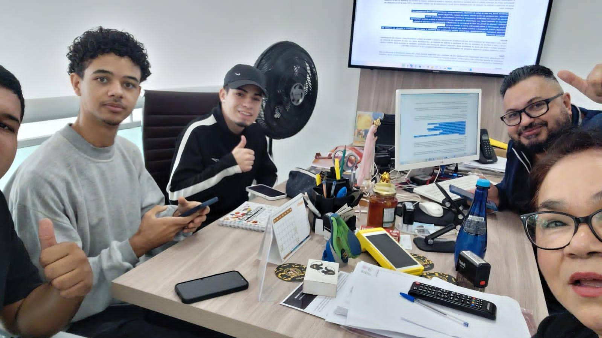
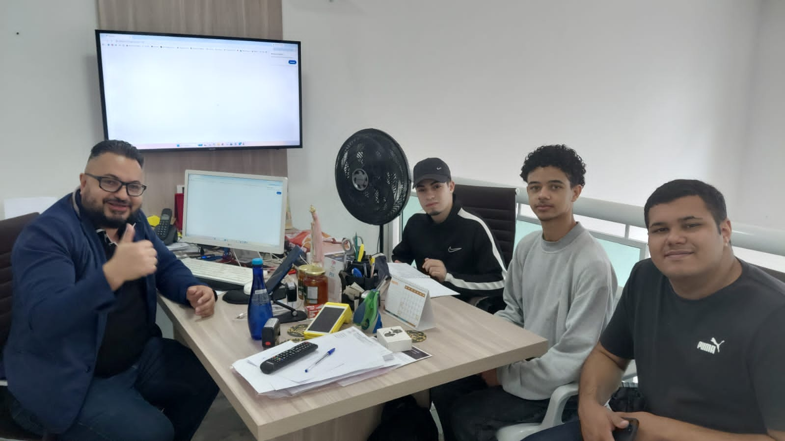
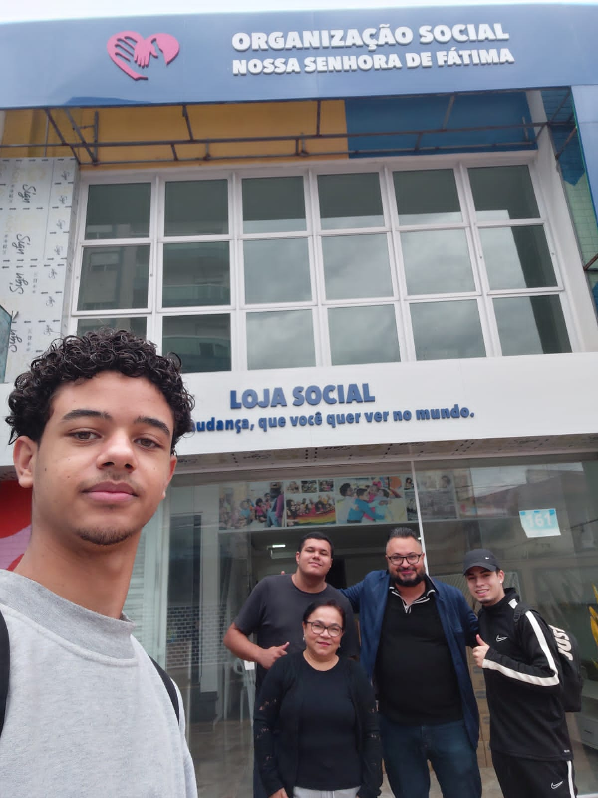
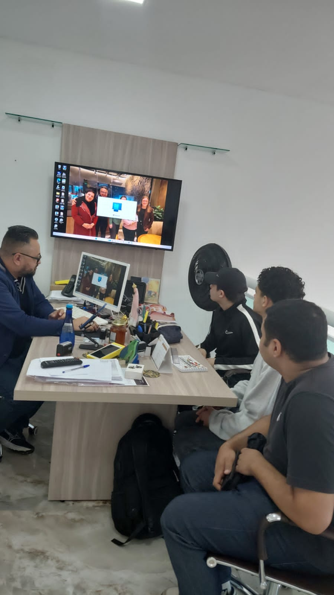
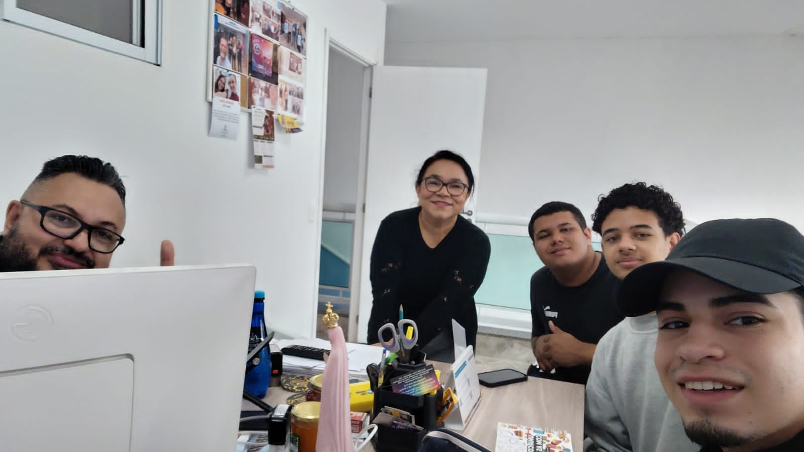

# Relatório Detalhado de Pesquisa de Campo e Levantamento de Requisitos

*Organização:* Organização Social Nossa Senhora de Fátima (CNPJ: 32.667.614/0001-18)  
*Data da Visita:* 12/09/2026  
*Horário:* 11:00 às 14:30  
*Local:* Rua Guaimbé, 161, Mooca, São Paulo - SP  
*Responsável Entrevistada:* Maria Aparecida Fernandes Ferreira de Souza (Assistente Social)  
*Participação Especial:* O integrante do grupo *Washington de Souza Silva* atua como *Presidente da ONG*, condição devidamente comunicada e alinhada com as diretrizes acadé
êmicas da disciplina para o desenvolvimento do projeto.

---

## 1. Cronograma e Dinâmica da Visita Presencial

A pesquisa de campo foi realizada presencialmente no dia 12 de setembro de 2026, estruturada nas seguintes etapas metodológicas:

1. *Tour e Reconhecimento Inicial (Aprox. 1 hora):*  
   Início às 11:00 com uma caminhada guiada pelas instalações da instituição. O grupo realizou o mapeamento visual da infraestrutura física, áreas de receção de portas abertas, salas de atendimento social e locais de armazenamento temporário de mantimentos e doações.

2. *Alinhamento Institucional e Contextualização (Aprox. 1 hora e 30 minutos):*  
   Conversa aprofundada com a assistente social Maria Aparecida e com o presidente da instituição e integrante do grupo, Washington de Souza Silva. O objetivo foi compreender em detalhes a missão da ONG, o fluxo de acolhimento da população em vulnerabilidade social na Mooca, o recebimento de doações de parceiros (como o Banco de Alimentos e o projeto Cidade Invisível) e a gestão do lote bimestral de 150 cestas básicas repassado pela Prefeitura.

3. *Entrevista Técnica e Coleta de Requisitos (Última etapa):*  
   Aplicação de um roteiro técnico pré-preparado em formato de checklist/PDF pela equipe acadêmica. Nessa fase, foram levantados os requisitos funcionais, não funcionais, regras de negócio e os dados específicos necessários para a construção prática da modelagem conceitual do banco de dados (DER), mapeando campos essenciais de cadastro, triagem, encaminhamentos e prontuários.

---

## 2. Respostas às Perguntas da Pesquisa de Campo (Diagnóstico da ONG)

Conforme as diretrizes exigidas para o levantamento, detalham-se abaixo as respostas colhidas in loco sobre a operação da instituição:

* *Principais atividades realizadas:* Acolhimento social de "porta aberta", triagem socioeconômica, concessão de auxílios alimentares (cestas básicas), encaminhamentos para a rede externa (saúde, habitação e jurídica) e suporte continuado via Plano Individual de Atendimento (PIA).
* *Perfil dos beneficiários e cadastro:* Pessoas e famílias em situação de vulnerabilidade social na região da Mooca (cerca de 250 famílias ativas). O cadastro é feito por meio de fichas impressas preenchidas durante a entrevista com a assistente social, coletando dados de identificação, composição familiar, renda e situação ocupacional.
* *Gestão de voluntários e doadores:* A ONG conta fixamente com o presidente e 5 voluntários recorrentes que auxiliam na receção e suporte operacional. Os doadores e parceiros estratégicos (como o Banco de Alimentos e o projeto Cidade Invisível) são mapeados de forma institucional.
* *Recebimento e controle de doações:* Os mantimentos chegam de forma esporádica por meio de doadores particulares ou de forma programada através de um lote bimestral de 150 cestas básicas da Prefeitura. O controle físico dos alimentos passa por inspeção visual de validade e integridade antes da distribuição.
* *Ferramentas e planilhas utilizadas atualmente:* O controle é quase inteiramente *manual e físico* (fichas de papel impressas em arquivo físico), gerando grande dependência de registros em papel.
* *Maiores dificuldades e problemas identificados:*
  * *Risco de perda e deterioração:* O papel sofre desgaste físico com o tempo.
  * *Gargalos de busca:* Dificuldade e lentidão para localizar o histórico de atendimentos antigos de um beneficiário.
  * *Segurança e LGPD:* O armazenamento físico em armários dificulta o controle rigoroso de acesso restrito exigido por lei para dados sensíveis.
* *Problema a ser resolvido pelo novo sistema:* A digitalização completa do fluxo de cadastros, fichas de triagem, histórico de atendimentos e controle de doações, eliminando a dependência do papel e garantindo agilidade e conformidade com a LGPD.

---

## 3. Registro Fotográfico da Visita Presencial

Abaixo encontra-se o registro fotográfico obtido durante a visita presencial às dependências da instituição, autorizado pela gestão para compor a documentação do projeto:

*Legenda: Imagem 1*

*Legenda: Imagem 2*

*Legenda: Imagem 3*

*Legenda: Imagem 4*

*Legenda: Imagem 5*
